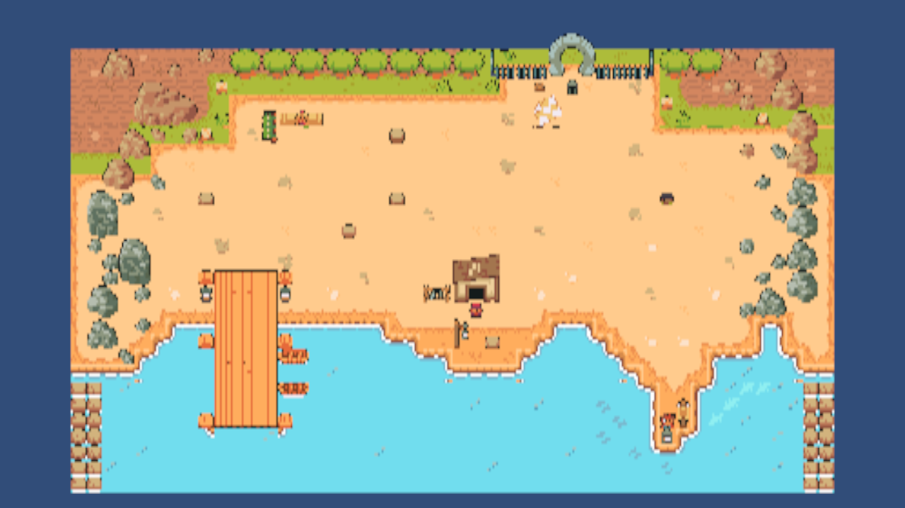
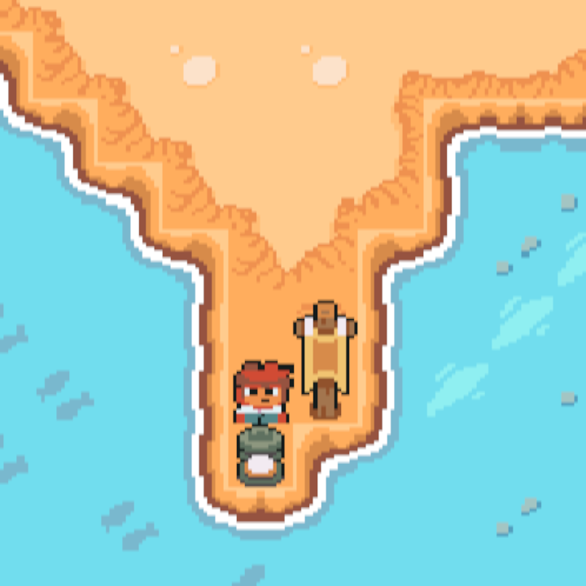

# Beach integration review

Validated locally on 11 November 2026 in **Unity 6000.3.12f1**.

## Changes

- Integrates `map-beta` with main's movement and dialogue prototypes, preserving
  both branches' history.
- Keeps Old Spin (`OldMan2`), the beach musician (`Village6`), young islander
  (`Villager3`) and knight (`Knight`). Removes `Kid1`; the knight is record
  guardian 3, not a fifth NPC for progression.
- Adds one existing DialogueCanvas prefab instance, explicitly wired dialogue
  components, and the existing PlayerMovementLock adapter.
- Replaces the NPCs' nonfunctional 3D colliders with solid Collider2D components.
- Preserves movement's 4 units/second, four directions and last-key priority.
  After visual review, sets Beach's player and NPC visuals to one tile tall,
  with centered **1 x 1** NPC colliders and a **0.85 x 0.85** player collider.
  The inset player box provides clearance for physics contacts and four-direction
  movement through one-cell corridors. Moves the spawn to a dock cell's center.
  PlayerMovement and the standalone movement
  prototype are unchanged; the unfinished Animator remains unassigned.
- Uses five isolated copies of the pack character sheets with 16x16 slices,
  centered pivots and 16 PPU. Original shared character importers and GUIDs stay
  identical to main. Copies contain exactly the original PNG bytes.
- Adds global 2D lighting for the existing Sprite-Lit materials. Retains the
  authored terrain, tile palette and Cinemachine
  3.1.7 camera.
- Replaces sprite-outline Water/Obstacles collision and hand-positioned prop/
  perimeter boxes with one dedicated **Collision** tilemap on the existing
  **1 x 1 world-unit grid**. Its Grid-collider tiles block complete cells:
  coast/perimeter, rocks, walls, five stumps, barrel, bench, dock posts, pot and
  both tall signs. Grass and flat decorative pebbles remain walkable.
  NPCs are snapped to cell centers. Repairs the
  missing inner foam corner at `(17, -14)` and matching dock corners at
  `(-14, -14)` / `(-9, -14)` using existing water tiles.

## Local verification

These are local automated Play Mode smoke checks using synthetic Input System
keyboard events, the actual unmodified player controller, and live 2D physics.
They are not a GitHub CI test run. Temporary verification tooling is excluded
from the game and its dependencies.

| Check | Result |
| --- | --- |
| Beach movement and dialogue smoke checks | 46 assertions passed |
| Original MovementTest smoke checks | 20 assertions passed during initial integration; scene unchanged by grid revision |
| Original DialogueTest smoke checks | 34 assertions passed during initial integration; scene unchanged by grid revision |
| Player input | WASD/arrows, speed 4, release stop, opposite keys and latest-axis priority passed; no diagonals |
| Dialogue | All four Beach NPCs open, advance, close and repeat; movement stops without drift and resumes |
| Multiple NPCs | Overlapping interaction ranges handled by one owner; closing press does not open another conversation |
| Beach traversal | Walked from dock spawn to each of the four NPCs and back using real keyboard input; no stuck routes |
| Route geometry | All four interaction areas reachable with the full player box plus clearance margin |
| Grid collision audit | 641 blocked cells have live physics; 736 unblocked ground cells have player-sized environment clearance |
| Reported trouble spots | Walked the peninsula lane, cabin pole/stump gap and eastern rock gap; stumps/barrel stop the player |
| Map perimeter | Blocked non-ground cells and an outer ring replace separate perimeter boxes |
| Scene physics | No remaining 3D colliders in Beach |
| Collision regression | 2,049 assertions passed for grid geometry, character sizes/alignment, blocked props and live movement |
| Console | Zero errors/warnings after final Beach checks; prototypes previously verified during initial integration |
| Asset integrity | No missing asset/folder .meta files or duplicate asset GUIDs |

During automation the Input System's focus routing was temporarily adjusted so
synthetic keyboard input reached the unfocused Game View. Previous settings and
the real keyboard were restored after each test. Runtime NPC/player positions
used by tests were not saved to the scene.

## Reproduce a manual smoke check

1. Open `Assets/Scenes/Beach_Level/Beach.unity` and enter Play Mode.
2. Walk off the dock onto the beach. Check WASD/arrows, instant release stop,
   no diagonal movement, and last-key priority while holding multiple keys.
3. Approach Old Spin by the cabin, musician northwest, islander east, and
   knight by the north gate. Press E to read and finish each conversation.
4. Hold movement during dialogue: the player should remain stationary. Close
   and reopen each conversation, then confirm movement works again.
5. Walk into a solid NPC, water, stump and barrel; verify they stop the player.
   Walk down the peninsula's left lane, between the cabin pole and stump, and
   through the eastern rock gap. Walk to each NPC and back to the dock.
6. Check camera follow and the Console. Also run MovementTest and DialogueTest
   if editing shared movement or dialogue later.

## Editing collision

The visible art and collision are separate layers. Paint solid cells in
`Grid/Collision` using `Assets/Tiles/Beach/Collision/Blocked.asset`; erase a cell
to make it walkable. The tile uses **Collider Type: Grid**, independent of its
sprite's outline. Adjacent tiles are merged by a static CompositeCollider2D.
Do not add colliders back to Water or Obstacles or modify shared tile assets.

The Collision TilemapRenderer is disabled in the saved scene. Temporarily enable
it to see the red overlay while editing, then disable it again before saving.
Keep the Collision GameObject and its physics components enabled. When moving
solid art or changing the coast, update the corresponding Collision cells too;
there is no runtime generator that follows art edits. Maintain an outer blocked
ring when expanding the map. Keep stationary NPCs at cell centers with 1 x 1 boxes.
Player visuals stay one cell tall; retain the smaller 0.85 x 0.85 physical box.
Movement is continuous in four directions, without snapping the player to cells.

## Scope and follow-up

All NPCs are stationary and immediately available. English dialogue is placeholder
text. No challenge, record reward, fake win, sequential hint, gate unlock, pause
menu or NPC wandering is implemented here. Existing public dialogue/movement
contracts and project build settings are unchanged. **No Windows build was made.**

After this PR is merged, base new Beach work on updated main and coordinate
concurrent edits to the scene. Use the committed .meta files; do not independently
reimport/reslice shared character sheets to obtain Beach's scale.

## Screenshots

The overview and close-up were captured before the grid-collision revision and
show the authored art. They use temporary review cameras, which are not saved
in the scene. Collision and dialogue were verified separately in Play Mode.

Walking animations and directional standing poses already exist in the asset
pack and are tracked in [Trello](https://trello.com/c/HTDv0uXE). The four Idle
frames are facing directions, not a four-frame idle loop; NPC wandering is
still excluded.
