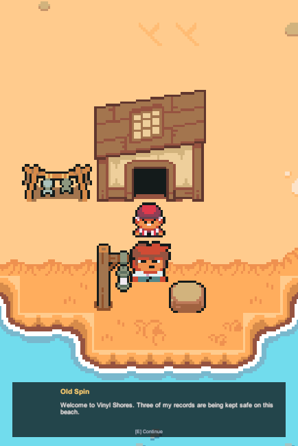

# Beach integration review

Validated locally on 11 November 2026 in **Unity 6000.3.12f1**.

## Changes

- Integrates `map-beta` with main's movement and dialogue prototypes, preserving
  both branches' history.
- Keeps Old Spin (`OldMan2`), the beach musician (`Village6`), young islander
  (`Villager3`) and knight (`Knight`). Removes `Kid1`; the knight is record
  guardian 3, not a fifth NPC for progression.
- Adds one existing DialogueCanvas prefab instance, explicitly wired dialogue
  components, and the existing PlayerMovementLock adapter.
- Replaces the NPCs' nonfunctional 3D colliders with solid Collider2D components.
- Preserves movement's 4 units/second, four directions, last-key priority and
  effective player box of **0.6293 x 1.189** world units. Removes the unfinished
  Animator assignment without editing PlayerMovement.
- Uses five isolated copies of the pack character sheets with 16x16 slices,
  centered pivots and 16 PPU. Original shared character importers and GUIDs stay
  identical to main. Copies contain exactly the original PNG bytes.
- Adds global 2D lighting for the existing Sprite-Lit materials and four solid
  perimeter walls. Retains the authored terrain, tile palette and Cinemachine
  3.1.7 camera.

## Local verification

These are local automated Play Mode smoke checks using synthetic Input System
keyboard events, the actual unmodified player controller, and live 2D physics.
They are not a GitHub CI test run. Temporary verification tooling is excluded
from the game and its dependencies.

| Check | Result |
| --- | --- |
| Beach movement and dialogue smoke checks | 46 assertions passed |
| Original MovementTest smoke checks | 20 assertions passed |
| Original DialogueTest smoke checks | 34 assertions passed |
| Player input | WASD/arrows, speed 4, release stop, opposite keys and latest-axis priority passed; no diagonals |
| Dialogue | All four Beach NPCs open, advance, close and repeat; movement stops without drift and resumes |
| Multiple NPCs | Overlapping interaction ranges handled by one owner; closing press does not open another conversation |
| Beach traversal | Walked from dock spawn to each of the four NPCs and back using real keyboard input; no stuck routes |
| Route geometry | All four interaction areas reachable with the full player box plus clearance margin |
| Solid collision | Player stopped against the young islander's Collider2D and the water at the dock's south edge |
| Map perimeter | Four enabled non-trigger Collider2D walls verified by raycasts |
| Scene physics | No remaining 3D colliders in Beach |
| Console | Zero errors/warnings after final gameplay checks in all three scenes |
| Asset integrity | No missing asset/folder .meta files or duplicate asset GUIDs |

During automation the Input System's focus routing was temporarily adjusted so
synthetic keyboard input reached the unfocused Game View. Previous settings and
the real keyboard were restored after each test. Runtime NPC/player positions
used by tests were not saved to the scene.

## Reproduce a manual smoke check

1. Open `Assets/Scenes/Beach_Level/Beach.unity` and enter Play Mode.
2. Walk off the dock onto the beach. Check WASD/arrows, instant release stop,
   no diagonal movement, and last-key priority while holding multiple keys.
3. Approach Old Spin by the cabin, musician northwest, islander east, and
   knight by the north gate. Press E to read and finish each conversation.
4. Hold movement during dialogue: the player should remain stationary. Close
   and reopen each conversation, then confirm movement works again.
5. Walk into a solid NPC and the water; verify they stop the player. Walk to
   each NPC and back to the dock, including corners and narrow approaches.
6. Check camera follow and the Console. Also run MovementTest and DialogueTest
   if editing shared movement or dialogue later.

## Scope and follow-up

All NPCs are stationary and immediately available. English dialogue is placeholder
text. No challenge, record reward, fake win, sequential hint, gate unlock, pause
menu or NPC wandering is implemented here. Existing public dialogue/movement
contracts and project build settings are unchanged. **No Windows build was made.**

After this PR is merged, base new Beach work on updated main and coordinate
concurrent edits to the scene. Use the committed .meta files; do not independently
reimport/reslice shared character sheets to obtain Beach's scale.

## Screenshots

The overview uses a temporary review camera to show the entire authored map;
that camera is not saved in the scene. The image below is the actual Game View.

